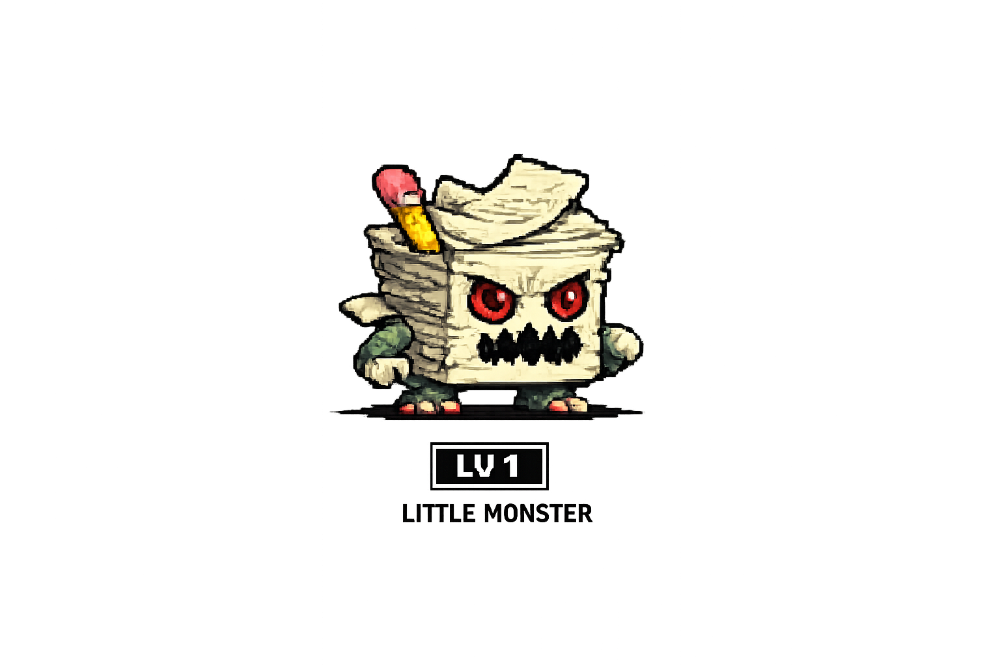
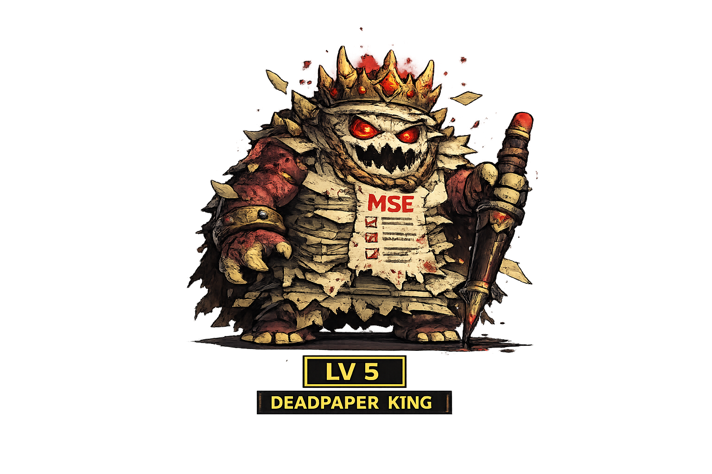

<div align="center">

# 🎮 ACADEMIC SURVIVOR
### *A High-Stakes Semester Escape & Territory Capture Simulator*

[](https://phaser.io/)
[](https://developer.mozilla.org/en-US/docs/Web/JavaScript)
[](https://developer.mozilla.org/en-US/docs/Web/API/Canvas_API)
[](https://Shreesh-o.github.io/Academic_Survivor/)
[](LICENSE)

<br/>

> **"Draw boundaries. Claim territory. Don't let deadlines crush your GPA."**  
> Inspired by retro arcade classics like **Qix**, **Volfied**, and **Paper.io**, infused with the raw tension of college engineering survival.

<br/>

[🕹️ **Play Academic Survivor in your Browser**](https://Shreesh-o.github.io/Academic_Survivor/) • [✨ Features](#-game-features) • [👾 Enemy Roster](#-the-academic-hierarchy-enemy-roster) • [⌨️ Controls](#-controls) • [🚀 Quickstart](#-quick-start-run-locally)

---

</div>

<br/>

## 📜 The Lore

You are a tired student stranded in an expansive academic arena. Your only lifeline to graduation is to **carve out safe territory** by looping across the map.

- **Green Territory = Sanctuary**: You are completely safe inside captured land.
- **The Open Arena = Danger**: Stepping outside creates a fragile, glowing trail.
- **The Threat**: Academic responsibilities roam the grounds. If an Assignment, Exam, or the dreaded **HOD** collides with your open trail or body, your enrollment is terminated on the spot.

**Win Condition**: Capture **≥ 75%** of the campus area to survive the semester!

---

## ✨ Game Features

- 🕹️ **Classic Arcade Loop Mechanics**: Smooth grid-based polygon flood-fill capture algorithm.
- 🗺️ **Dynamic Camera Scaling**: The camera begins zoomed close to your player and intelligently pulls back as your territory expands across higher levels.
- ⚡ **Multi-Tiered Difficulty Scaling**: Each milestone spawns deadlier, faster, and smarter threats.
- 🎓 **The Legendary HOD Boss**: An apex predator enemy that tracks your trail endpoints at ludicrous speed.
- 🎵 **Integrated Sound & Music**: Atmospheric background tracks, dynamic audio toggles, and brutal game-over cues.
- 📱 **Zero Install Required**: Runs directly in any modern desktop or mobile web browser.

---

## 🕹️ Gameplay Breakdown

```
  SAFE GROUND (Captured)
┌───────────────────────┐
│                       │
│    Player 🧍───┐      │   <-- Leaving safe ground draws a VULNERABLE trail
│                │      │
│                │ ⚡    │   <-- Danger! Enemies will hunt this trail!
│                ▼      │
│          Enclose Loop │   <-- Reconnecting to safe ground triggers capture!
│                       │
└───────────────────────┘
```

1. **Venture Out**: Step beyond your safe borders to deploy a trail.
2. **Enclose Territory**: Loop back to any existing captured tile to seal the perimeter.
3. **Flood-Fill Capture**: The enclosed area instantly converts into safe, green campus ground.
4. **Evade Threats**: If any enemy hits your trail before the loop closes: **Detained (Game Over)**.

---

## 👾 The Academic Hierarchy (Enemy Roster)

| Level | Threat | Sprite | Speed | Behavior & Intel |
| :---: | :--- | :---: | :---: | :--- |
| **01** | **Assignments** |  | `55 px/s` | **Daily Nuisance**<br>High in volume (8x), slow bouncing movement. Ideal for warmup captures. |
| **02** | **Practicals** |  | `90 px/s` | **Lab Chaos**<br>Noticeably faster ricochets. Punishes overly ambitious trail loops. |
| **03** | **ISE Exams** |  | `110 px/s` | **Internal Evaluation**<br>Larger hitbox, moderate speed. Takes up massive clearance space. |
| **04** | **MSE** |  | `130 px/s` | **Mid-Sem Menace**<br>Switches from random bounces to **active player pursuit**. |
| **05** | **ESE** |  | `160 px/s` | **End-Sem Extinction**<br>Extremely fast and aggressive chase AI. High mortality rate. |
| **06** | **The HOD** |  | `190 px/s` | **Final Boss**<br>Massive size, Ludicrous speed, relentless hunter. **Immune to excuses.** |

---

## ⌨️ Controls

| Key / Action | Command |
| :--- | :--- |
| <kbd>W</kbd> or <kbd>↑</kbd> | Move Up |
| <kbd>S</kbd> or <kbd>↓</kbd> | Move Down |
| <kbd>A</kbd> or <kbd>←</kbd> | Move Left |
| <kbd>D</kbd> or <kbd>→</kbd> | Move Right |
| <kbd>🔊 / 🔇</kbd> *(Top Right HUD)* | Toggle Background Music |
| <kbd>R</kbd> *(Game Over Screen)* | Repeat Semester (Restart) |

---

## 🏆 Semester Evaluation (Grade Card)

Your final grade reflects the percentage of campus territory conquered:

| Grade | Campus Captured | Academic Status |
| :---: | :---: | :--- |
| <span style="color:#ffcc00; font-weight:bold;">S</span> | **90% – 100%** | **Gold Medalist / College Topper** — Legendary status. |
| <span style="color:#44ff88; font-weight:bold;">A</span> | **75% – 89%** | **Graduated** — Semester cleared with distinction. |
| <span style="color:#00d4ff; font-weight:bold;">B</span> | **60% – 74%** | **Surviving** — Barely made the attendance criteria. |
| <span style="color:#ff8c00; font-weight:bold;">C</span> | **45% – 59%** | **Struggling** — Sleepless nights, barely floating. |
| <span style="color:#ff4444; font-weight:bold;">D</span> | **30% – 44%** | **KT Pending** — Remedial examination summons waiting. |
| <span style="color:#888888; font-weight:bold;">F</span> | **< 30%** | **Detained** — Year drop. See you next batch. 💀 |

---

## 🧠 Survival Strategies

> [!TIP]
> **1. Perimeter Nibbling**: Start by shaving off thin strips hugging the outer borders. Short trails mean a near-zero risk window.  
> **2. Bait and Switch**: When chasing enemies like MSE or ESE approach, lure them to one side of your safe haven before darting out toward the other.  
> **3. Respect The HOD**: Do not attempt large captures once Level 6 begins. The HOD traverses half the arena in seconds—make small, rapid 2-3% bites.  
> **4. Sound is Intel**: Keep the audio enabled for cues on level transitions and immediate threat alerts.

---

## 🚀 Quick Start (Run Locally)

Because the game uses Phaser 3 to load external textures and audio files, it should be served via a local HTTP server to prevent browser CORS restrictions.

### Option 1: Python (Recommended)
```bash
# Clone the repository
git clone https://github.com/Shreesh-o/Academic_Survivor.git
cd Academic_Survivor

# Start server
python3 -m http.server 8000
```
Open **`http://localhost:8000`** in your browser.

### Option 2: Node.js / NPX
```bash
npx serve .
```

### Option 3: VS Code Live Server
1. Install the **Live Server** extension in VS Code.
2. Right-click on `index.html` and click **"Open with Live Server"**.

---

## 📂 Project Architecture

```
Academic_Survivor/
├── Assets/                      # Character, Enemy Artwork & Audio Assets
│   ├── Hero.png                 # Player sprite
│   ├── Level1-Assignmets.png    # Level 1 Enemy
│   ├── Level 2-Practicals.png   # Level 2 Enemy
│   ├── Level 3-ISE.png          # Level 3 Enemy
│   ├── Level-4-MSE.png          # Level 4 Enemy
│   ├── Level-5-ESE.png          # Level 5 Enemy
│   ├── Final boss.png           # Level 6 Final Boss (The HOD)
│   ├── background.jpg           # Game arena blueprint
│   ├── bg_music.mp3             # Background track
│   └── faaa.mp3                 # Game over audio cue
├── scenes/                      # Modular Scene Architecture
│   ├── BootScene.js             # Asset loading & progress bar display
│   ├── MenuScene.js             # Main menu, interactive start & audio toggle
│   ├── GameScene.js             # Core game loop, player physics & HUD
│   ├── GameOverScene.js         # Death screen, stats & retry handler
│   └── WinScene.js              # Victory celebrations & final percentage
├── scripts/                     # Engine & Game Math
│   ├── constants.js             # Global parameters, colors & enemy configs
│   ├── EnemyManager.js          # Physics bodies, bounce math & trail hitboxes
│   └── GridManager.js           # 2D capture matrix & flood-fill algorithm
├── index.html                   # Game viewport & web font loading
├── main.js                      # Phaser game instance configuration
├── style.css                    # Dark arcade CRT aesthetic styling
└── README.md                    # Project documentation
```

---

## 🛠️ Built With

- **[Phaser 3](https://phaser.io/)** — 2D Web Game Framework (Physics, Scene Management, Cameras)
- **HTML5 Canvas** — Hardware-accelerated graphics rendering
- **Vanilla JavaScript (ES6+)** — Object-Oriented Scene & State Architecture
- **CSS3** — Custom CRT Scanlines, Retro Typography & Arcade styling

---

## 🤝 Contributing

Got ideas for new academic power-ups (*"Proxy Attendance"*, *"Mass Bunker"*) or new faculty bosses? Pull Requests and suggestions are warmly welcome!

1. Fork the Project
2. Create your Feature Branch (`git checkout -b feature/NewPowerup`)
3. Commit your Changes (`git commit -m 'Add Proxy Attendance Powerup'`)
4. Push to the Branch (`git push origin feature/NewPowerup`)
5. Open a Pull Request

---

<div align="center">

Made with ☕, caffeine, and the eternal terror of detention.  
**Good luck surviving this semester!**

</div>
